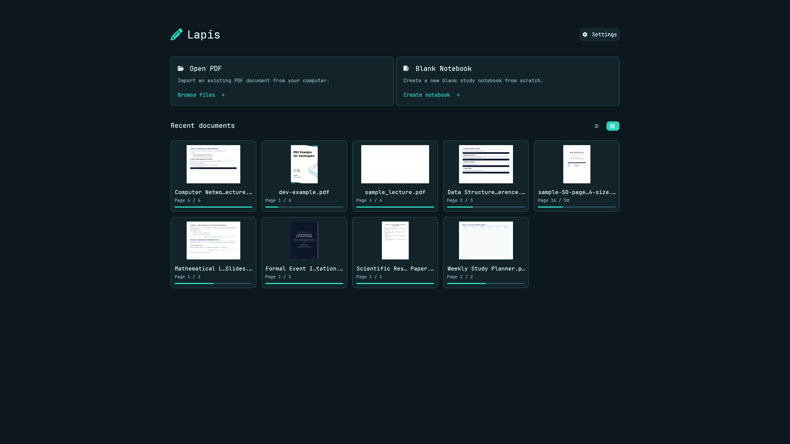
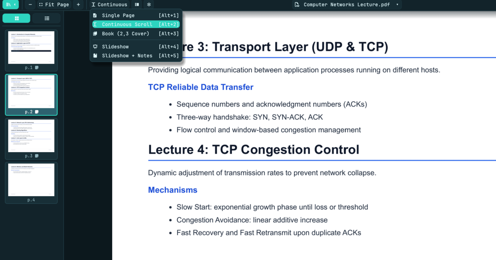
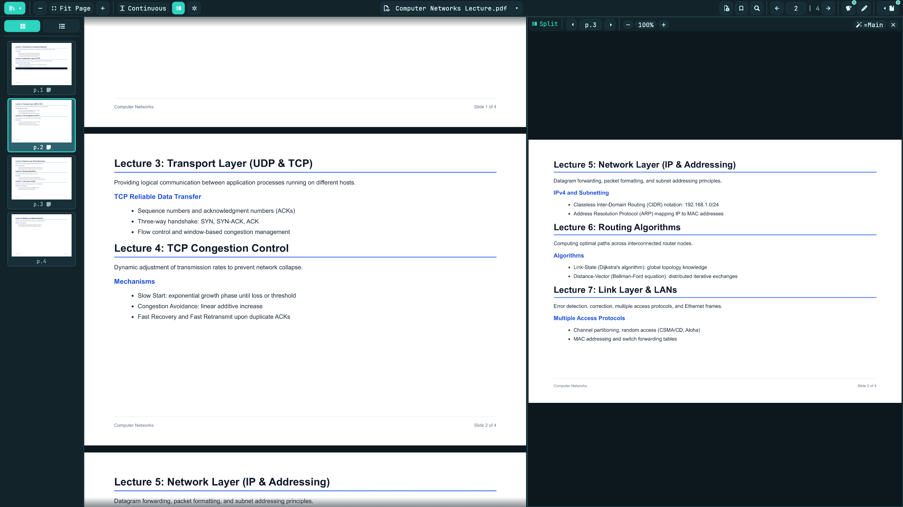
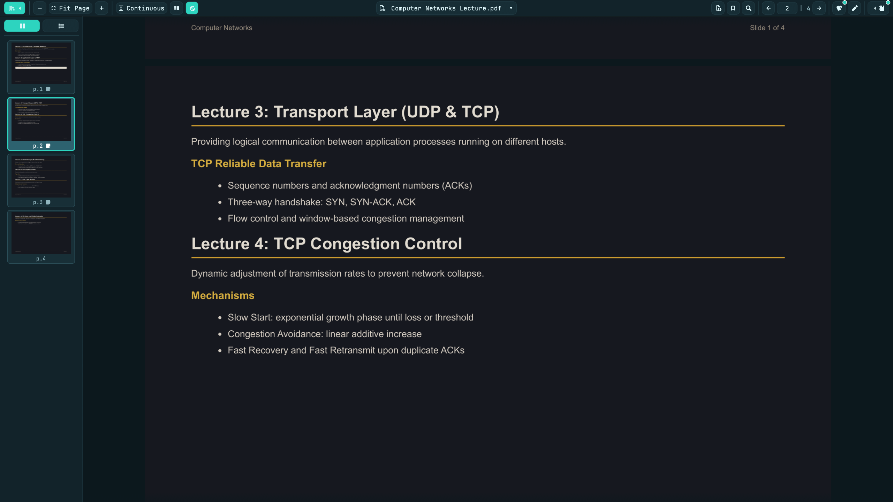
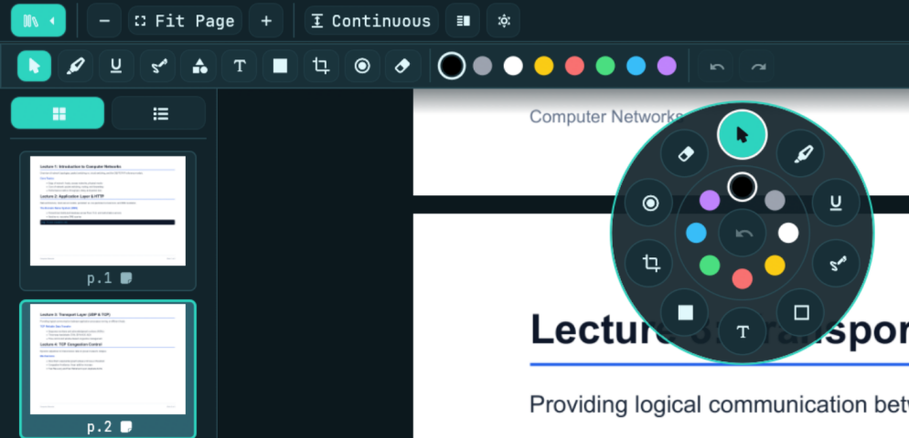
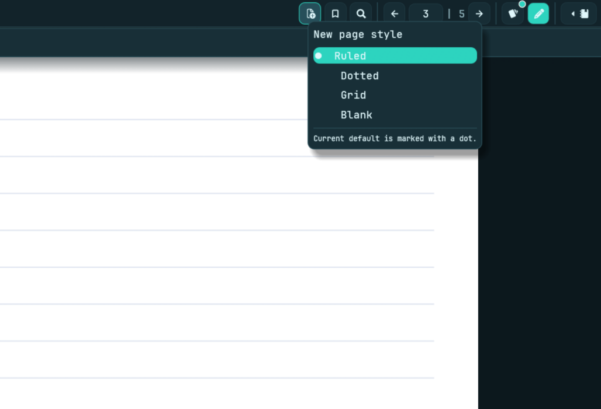
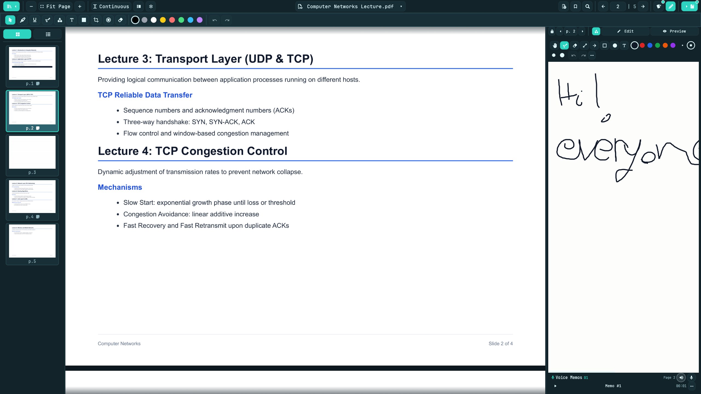
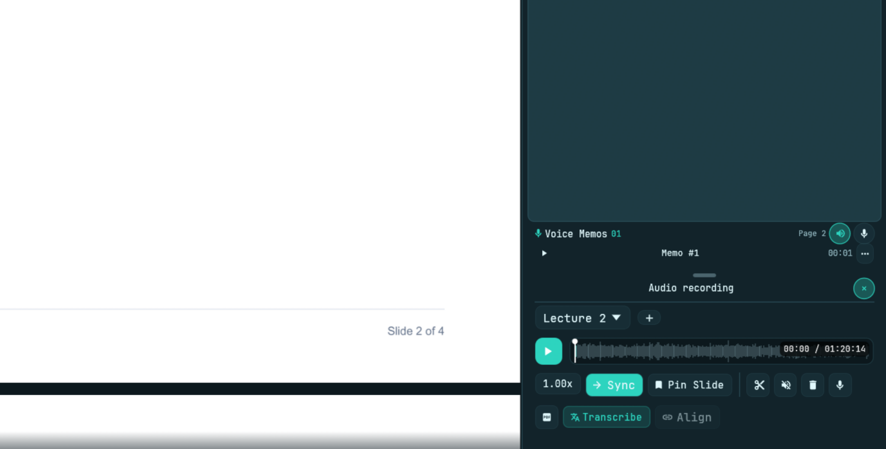
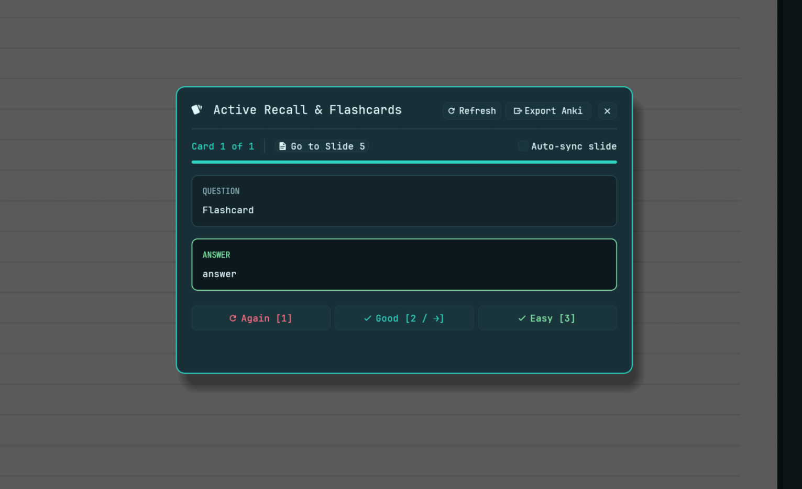

# Lapis User Guide

> Back to the [README](../README.md): installation, keyboard shortcuts, technical overview and roadmap.

This guide explains how to use the main Lapis features, from opening a PDF to building a complete study workflow.

## Contents

1. [Opening a document](#1-opening-a-document)
2. [PDF Viewing Modes](#2-pdf-viewing-modes)
3. [Split View](#3-split-view)
4. [PDF Night Mode](#4-pdf-night-mode)
5. [Page Navigation](#5-page-navigation)
6. [Annotation Tools](#6-annotation-tools)
7. [Custom Study Pages](#7-custom-study-pages)
8. [Markdown Notes](#8-markdown-notes)
9. [Spellchecking and Dictionaries](#9-spellchecking-and-dictionaries)
10. [Lecture Audio Workspace](#10-lecture-audio-workspace)
11. [Offline Lecture Transcription](#11-offline-lecture-transcription)
12. [Voice Memos](#12-voice-memos)
13. [Flashcards & Active Recall](#13-flashcards--active-recall)
14. [Search & Command Palette](#14-search--command-palette)
15. [Settings & Customization](#15-settings--customization)
16. [Importing and Exporting Notes](#16-importing-and-exporting-notes)


This section explains how to use the main Lapis features, from opening a PDF to building a complete study workflow.

## 1. Opening a document

Start by opening a PDF through the **Open PDF** action or by dragging a PDF into the application.

<p align="center">
  
</p>

Once a document is loaded, Lapis provides a workspace containing the PDF viewer, navigation controls, annotation tools, notes, and study features.

The current document is the context for your work: notes, annotations, bookmarks, and associated audio information are organized around its pages.

### Saving your work

Use the Save action or its keyboard shortcut to save notes and annotations.

Lapis stores document data locally and associates it with the PDF. A local backup is also maintained by the document-data storage system.

When moving a PDF to another computer, remember to consider its associated Lapis data as well.

---

## 2. PDF Viewing Modes

The View Mode menu offers five ways to work with a document.

<p align="center">
  
</p>

### Single Page — `Alt + 1`

Displays one page at a time.

Use this mode when you want to concentrate on a single slide, annotate it, or read its associated notes.

### Continuous Scroll — `Alt + 2`

Displays pages in a vertical sequence.

This is useful for reading longer documents without manually changing pages.

Press `C` (when not typing) to toggle between Continuous Scroll and Single Page. The key can be changed in
**Settings → Keybindings**.

### Two-Page Book View — `Alt + 3`

Displays two pages side by side, simulating an open book.

The Book mode supports two page arrangements:

- **Pair (1,2):** starts with pages 1 and 2 together.
- **Cover (2,3):** treats the first page as a separate cover and pairs pages 2 and 3.

When already in Book mode, selecting the mode again toggles between these arrangements.

### Slideshow — `Alt + 4`

Turns the PDF into a presentation view.

The document is displayed as a sequence of slides, making it suitable for presenting lecture material or reviewing slides without the normal reading interface.

Use the available navigation controls or keyboard shortcuts to move between pages. The slideshow interface also provides an Exit control.

### Slideshow + Notes — `Alt + 5`

Combines the presentation view with the notes workspace.

This mode is useful when presenting or reviewing a slide while keeping its associated notes available.

### Fullscreen — `F11`

Any view mode can be shown fullscreen, not only the slideshow modes. Press `F11` (or use
**Toggle Fullscreen** in the Command Palette) to enter or leave fullscreen. The shortcut can be changed in
**Settings → Keybindings**.

Fullscreen also works in tiling compositors such as Hyprland. If you leave fullscreen with a compositor
keybinding, Lapis follows that change instead of forcing fullscreen back. In the slideshow modes `F11` has no
effect: press `Esc` to exit them.

---

## 3. Split View

Split View displays two PDF pages side by side.

Enable it using the **Split View** toolbar action.

<p align="center">
  
</p>

This is particularly useful when:

- Comparing two slides.
- Reading a diagram alongside its explanation.
- Referring to an earlier page while annotating the current one.

Both displayed pages can be used as part of the annotation workflow.

---

## 4. PDF Night Mode

Use the **PDF Night Mode** toolbar button to toggle the PDF's dark viewing treatment.

<p align="center">
  
</p>

This changes the PDF viewing appearance without requiring you to modify the original document.

It is useful for studying in darker environments or when a bright PDF background is distracting.

---

## 5. Page Navigation

Lapis provides several ways to navigate through a document.

### Page thumbnails

Use the thumbnails sidebar to navigate visually.

Selecting a thumbnail takes you to the corresponding page.

### Document outline

The Outline sidebar provides a structured navigation view when outline information is available.

### Bookmarks

Use the Bookmark action to add or edit a bookmark for the current page.

Bookmarks make it easier to return to important slides, formulas, or sections.

### Keyboard navigation

You can move between pages using:

- Left / Right Arrow when a text field is not focused.
- `K` / `J` when a text field is not focused.
- `PageUp` / `PageDown`.
- The configurable global previous/next slide shortcuts.

The Alt-based navigation shortcuts are also available inside the notes editor.

---

## 6. Annotation Tools

Lapis includes a collection of annotation tools for marking up PDF pages.

<p align="center">
  
</p>

Select a tool from the annotation toolbar (two versions available in advanced settings: orizontal sub-topbar and vertical). The radial tools menu can also be used when enabled in Settings and can be opened with a right click anywhere on the PDF: you can select something from these menu using right-click (and the menu does not close) or left-click (to close the menu right after the selection).
> You can draw simply by holding down the Spacebar and moving the cursor, offering a much more ergonomic workflow on laptops without needing to click and drag on the touchpad (Note: ensure "Disable touchpad while typing" is turned off in your OS settings).

### Cursor

Use the Cursor tool to interact with existing content and annotations without drawing a new mark.

### Draw / Pen

Create freehand annotations directly over the PDF.

The drawing system supports smoothed strokes, making handwritten annotations easier to read.

### Highlight

Emphasize important portions of a page.

Use it to mark definitions, key sentences, or important regions of a diagram.

### Underline

Draw underlines to emphasize specific text or visual elements.

### Shapes

Create geometric annotations, including:

- Rectangles
- Circles
- Lines
- Arrows

Use these to highlight regions, connect concepts, or explain diagrams.

### Text Box

Place text annotations directly on a PDF page.

This is useful for short explanations, labels, and reminders that should remain visually attached to the slide.

### Eraser

Remove annotations from the page.

### Occlusion Tape — Active Recall

Occlusion Tapes cover selected regions of a slide.

They are designed for self-testing: cover a formula, label, definition, or diagram component, then try to recall the hidden information before revealing it.

Click an existing tape to peek at or reveal its covered content.

The Settings panel also provides actions to:

- Cover all tapes for quiz mode.
- Reveal all tapes.

This makes it possible to turn annotated lecture slides into interactive recall exercises without creating separate flashcards.

### Snip Tool

The Snip tool captures a selected rectangular region of the current slide.

To use it:

1. Select the Snip tool.
2. Drag over the region you want to capture.
3. Complete the selection.
4. Lapis saves the crop and inserts a Markdown image reference into the notes associated with that page.

This is useful for copying diagrams, equations, charts, and other visual elements into your study notes.

### Laser Pointer

The Laser tool provides a temporary visual pointer for presentations.

Use it to draw attention to a particular area of the current slide without creating a permanent annotation.

---

## 7. Custom Study Pages

Lapis can insert additional pages into a PDF document.

Use the **New Page** toolbar button to insert a page after the current page.

<p align="center">
  
</p>

A normal click inserts a page using the configured default style.

Right-click the button to choose a different style:

| Style | Description |
|---|---|
| Ruled | Traditional horizontal writing lines. |
| Dotted | Subtle dots for flexible handwriting and diagrams. |
| Grid | Regular square grid for diagrams, calculations, and structured notes. |
| Blank | Completely empty page. |

The current default style is marked in the page-style menu.

You can also change the default style in **Settings → Study & Canvas**.

Custom pages are useful for adding handwritten-style notes, calculations, diagrams, or additional explanations between existing PDF slides.

---

## 8. Markdown Notes

Each PDF page can have its own Markdown notes.

Use the notes panel to write explanations, summaries, formulas, and study material associated with the current slide.

### Edit mode

Edit mode provides the Markdown writing area.

You can use Markdown syntax to structure your notes with:

- Headings
- Bold and italic text
- Lists
- Numbered steps
- Links
- Code blocks, with syntax highlighting for many programming languages (use a fenced block such as
  ```` ```python ````, ```` ```cpp ````, ```` ```js ````, ```` ```sql ```` ...)
- Mathematical expressions

### Preview mode

Switch to Preview to see the formatted result rather than the raw Markdown source.

Use the Edit / Preview shortcut to switch between the two modes.

### Sketch

The **Sketch** tab, to the left of Edit and Preview, is a scratchpad attached to the current page, for
diagrams, quick calculations or anything that is easier to draw than to type. Each PDF page has its own
sketch, and it follows the note page shown in the panel header. Only the strokes and the background are saved,
like notes.

<p align="center">
  
</p>

The canvas fills the whole panel below its toolbar and grows as you draw, so there are no page edges and it
works the same in a narrow side panel and in a wide bottom panel (moving the panel never changes what you
drew, it only shows a different part of the canvas). To move around use the **hand** tool, drag with the middle
mouse button, or scroll with the wheel / trackpad; the canvas also scrolls by itself when you draw close to the edge
of the panel. A thin scroll bar at the edge shows where you are and whether there is more canvas. `Ctrl + wheel` or
pinch zooms around the cursor.

Hold **Spacebar** and move the pointer to draw in the Sketch canvas without clicking. Release Space to finish the stroke. This works with the pen, shape tools, and eraser; the hand and text tools keep their normal interaction.

**Toolbar:**

- **Tools:** hand (moves the canvas), pen, eraser, line, arrow, rectangle, circle and text. The eraser removes
  whole strokes; the text tool creates a box where you click (click it again to edit it).
- **Colors and sizes:** six colors and four sizes, which also set the text size. In a very narrow panel they
  collapse into a single button.
- **Undo / Redo:** works on the sketch while it is the last thing you drew on (`Ctrl + Z` / `Ctrl + Y`).
- **Menu (`…`):** the background (blank, ruled, grid, dotted) for this page, zoom and *Clear sketch*
  (which can be undone).

Sketches are saved with the document and move with their page when you insert, delete or reorder pages. They are
included in the PDF export together with the notes: to the right of the slide if the page has no notes, under the
notes if these are short, otherwise on a page right after the slide and its notes.

If you do not need them, turn the tab off in **Settings → Advanced Settings → Enable Sketch**; your sketches are
kept and the tab (and the sketches in exports) come back when you turn it on again.

### Mathematical notation

Lapis supports LaTeX-style mathematical notation.

Inline expression:

```markdown
The quadratic formula is $x = \frac{-b \pm \sqrt{b^2-4ac}}{2a}$.
```

Display expression:

```markdown
$$
E = mc^2
$$
```

Use inline mathematics for expressions inside paragraphs and display mathematics for equations that deserve their own line.

### Images in notes

The Snip tool can automatically insert captured slide regions into the current page's Markdown notes.

This allows you to combine explanatory text with selected visual content from the PDF.

---

## 9. Spellchecking and Dictionaries

Lapis includes offline spellchecking in the notes editor.

When spellchecking is enabled, words that are not recognized by the active dictionaries are underlined.

### Correcting a word

1. Locate an underlined word in the notes editor.
2. Right-click the word.
3. Choose one of the suggested corrections.

### Adding a custom word

If a word is correct but not recognized, use **Add to dictionary** in the context menu.

Custom words are stored locally and can be managed through:

**Settings → Dictionaries**

You can also add or remove custom words manually from that section.

### Additional dictionaries

The Dictionaries settings section lets you install full Hunspell dictionaries, including prefixes, suffixes, conjugated forms and inflections. Each language requires **both** a `.dic` word/flag file and its matching `.aff` rules file, with identical filenames before the extension (for example `it_IT.dic` and `it_IT.aff`).

1. Download both files for the language you need. You can get them directly from the LibreOffice dictionary repositories: 
  >    *To prevent the browser from opening the file as raw text, **right-click** on the links below and select **"Save link as..."** (or "Download linked file"):*
   * **Italian:** <a href="https://raw.githubusercontent.com/LibreOffice/dictionaries/master/it_IT/it_IT.dic" download>`.dic`</a> and <a href="https://raw.githubusercontent.com/LibreOffice/dictionaries/master/it_IT/it_IT.aff" download>`.aff`</a>
   * **French:** <a href="https://raw.githubusercontent.com/LibreOffice/dictionaries/master/fr_FR/dictionaries/fr.dic" download>`.dic`</a> and <a href="https://raw.githubusercontent.com/LibreOffice/dictionaries/master/fr_FR/dictionaries/fr.aff" download>`.aff`</a>
   * **German:** <a href="https://raw.githubusercontent.com/LibreOffice/dictionaries/master/de/de_DE_frami.dic" download>`.dic`</a> and <a href="https://raw.githubusercontent.com/LibreOffice/dictionaries/master/de/de_DE_frami.aff" download>`.aff`</a>
   * **Other Languages:** You can find dictionary files for many other languages in the official <a href="https://github.com/LibreOffice/dictionaries" target="_blank">LibreOffice Dictionaries Repository</a>.
   
   Keep each downloaded pair's original matching basenames.

2. Save the pair in the same folder, then open **Settings → Dictionaries → Add dictionary**, selecting both `.dic` and `.aff` files at once (multi-select). You can also select only one file now and add the missing partner later; Lapis warns about incomplete pairs and activates the language only after both files are present.

3. Lapis copies both files into its local dictionary directory and shows the full path to each `.aff` and `.dic` file in the installed dictionaries list. Use **Enable spellchecking** beside any added dictionary, or the checkbox for **English (built-in)**, to enable or disable that language without deleting its files. A word is accepted if any enabled dictionary recognizes it; suggestions display their source language (for example **IT** or **EN**) on the right.


A legacy `.txt` word list can still be loaded without affix rules. Dictionaries work offline after installation.

Spellchecking can also be enabled or disabled through the application settings.

---

## 10. Lecture Audio Workspace

Lapis includes an audio workspace for working with lecture recordings.

Open the Audio Lecture Dock using the expandable control at the bottom of the application.

<p align="center">
  
</p>

The audio workspace provides access to lecture playback, recording management, waveform navigation, trimming, and transcription.

### Loading audio

Import an existing audio track into the document's lecture workspace.

Loading a new lecture recording replaces the previous lecture track context and invalidates its old transcript and slide markers.

### Recording audio

Use the recording controls to capture a lecture directly from the application.

Once recorded, the audio becomes available for playback and transcription.

### Playback

Use the audio player to:

- Play and pause the recording.
- Navigate through the recording.
- Follow the current playback position.
- Use transcript timestamps to jump to specific moments.

The Space key can be used for play/pause when the relevant keyboard focus conditions allow it.

### Waveform

Lapis computes a visual waveform from the audio file.

The waveform provides a quick overview of the recording's amplitude and makes it easier to locate relevant portions of the lecture.

### Trimming audio

Use the visual range bar and its drag handles to select a portion of the recording.

This is useful for removing unwanted introductions, pauses, or irrelevant sections.

### Removing silence

The lecture audio tools also include automatic silence removal.

This operation detects sufficiently long silent regions, compacts the recording, and remaps associated slide markers and transcript timestamps to the new timeline.

Review the operation before using it on an important recording.

---

## 11. Offline Lecture Transcription

Lapis uses Parakeet to transcribe lecture recordings locally.

The transcription process runs in the background and reports its progress.

### Transcribing a lecture

1. Open the Audio Lecture Dock.
2. Load or record a lecture.
3. Make sure the Parakeet model is installed.
4. Start transcription.
5. Wait for the transcription process to complete.

The application processes audio in chunks and builds timestamped transcript segments.

### Slide-aware transcript

Lapis can associate transcript segments with individual PDF pages.

The transcript interface can display:

- Segments associated with the current slide.
- The transcript for all slides.
- The active segment during playback.

Selecting a timestamped segment moves the audio player to the corresponding moment.

This makes it possible to revisit what was said while a particular slide was being discussed.

### Appending transcript to notes

Use the transcript action to append transcript content to the Markdown notes.

This is useful when you want to preserve the spoken explanation alongside your written summary.

### Cancelling transcription

A running transcription can be cancelled.

The application retains the partial transcription produced before cancellation.

---

## 12. Voice Memos

Voice memos provide a way to record additional audio associated with individual PDF pages.

They are useful for:

- Personal explanations.
- Additional comments about a slide.
- Questions to revisit later.
- Short spoken summaries.

Voice memos are managed in the audio workspace and are associated with their respective pages.

### Transcribing a voice memo

Select the memo's transcription action to run Parakeet on that recording.

The resulting text is associated with the memo and its page.

Lecture transcription and voice-memo transcription share the same offline model infrastructure.

---

## 13. Flashcards & Active Recall

Lapis includes a flashcard trainer that extracts supported question-and-answer patterns from Markdown notes.

Open it using the **Flashcards** toolbar button or the corresponding Command Palette action.

<p align="center">
  
</p>

The trainer allows you to review cards, reveal answers, and track your study progress.

### Creating flashcards from notes

Lapis recognizes supported question-and-answer formats in your notes.

One supported format is:

```markdown
What is the function of mitochondria? :: ATP production through cellular respiration.
```

Another supported format is:

```markdown
Q: What is the function of mitochondria?
A: ATP production through cellular respiration.
```

Write these patterns in the notes associated with your document, then open the Flashcards trainer.

### Reviewing cards

The trainer presents questions and allows you to reveal their answers.

Use the available review controls to track whether you remembered each card.

### Anki export

Lapis can export supported flashcards to an Anki-compatible TSV file.

Use the **Export Flashcards to Anki (.tsv)** action in the Command Palette.

The resulting file can be imported into Anki for spaced-repetition review.

### Occlusion-based recall

Flashcards are not the only way to practice active recall.

Occlusion Tapes allow you to hide information directly on the PDF slide and test yourself in its original visual context.

---

## 14. Search & Command Palette

Lapis provides two distinct search and command interfaces.

### Global Search — `Ctrl + F`

Global Search searches across multiple types of document content:

- PDF slide text.
- Markdown notes.
- Audio transcripts.

Each result shows what it is (Note, Slide, Audio with its timestamp, or Memo), its page and the text around the match with your words highlighted. Results update as you type and the first match is shown immediately.

- **Enter** goes to the next result and **Shift + Enter** (or the **↑** / **↓** keys) to the previous one. The previous / next buttons do the same.
- The selected result is highlighted where it lives: on the PDF page, or in the notes editor (selecting a note result switches the notes panel to Edit mode).
- Closing the popup with **Esc**, the close button or `Ctrl + F` resets the search.

This is useful when you remember a concept or phrase but not where it appeared in the lecture.

### Command Palette — `Ctrl + P` / `Ctrl + K`

The Command Palette provides quick access to application actions.

It includes commands for navigating and launching features, such as:

- Opening Active Recall Flashcards.
- Exporting flashcards to Anki.
- Selecting annotation tools.
- Opening the Snip tool.
- Opening the Occlusion Tape tool.
- Inserting a new page.

Use the palette when you want to trigger an action without searching through the toolbar or menus.

---

## 15. Settings & Customization

Open Settings to configure the application.

Settings are divided into dedicated sections.

### Study & Canvas

Contains study-related and annotation options, including:

- Study and tool preferences.
- Occlusion Tape controls.
- Flashcard button visibility.
- Default page insertion style.
- Related workspace behavior.

### Theme & Fonts

Customize the application's visual appearance and typography.

Use these settings to adapt the workspace to your preferences.

### Keybindings

Lapis supports configurable keyboard shortcuts.

Open this section to inspect or reassign supported actions.

The interface also identifies conflicting shortcut combinations and provides an option to reset all configurable shortcuts to their defaults.

### System & Export

Contains document-management and export-related options.

Available actions include:

- Download the original PDF.
- Insert a new page.
- Choose what the PDF export contains: annotations, notes, or both.
- Configure the typography of exported notes.
- Configure the share of the page width used by the slide on pages with notes.
- Restore export defaults.

The export settings are: **Export content** (annotations only, notes only, or annotations + notes), the base font size of the notes, and the percentage of the page width occupied by the slide on pages that have notes. See [Exporting a PDF](#exporting-a-pdf).

### Storage & Data

Provides access to storage and document-data management.

Use this section to inspect and manage stored application data.

### Dictionaries

Manage additional dictionaries and custom words used by spellchecking.

---

## 16. Importing and Exporting Notes

Lapis supports importing and exporting notes independently of the original PDF.

### Importing notes

Import a `.txt` or `.md` file through the note-import action.

Lapis recognizes page headers such as:

```markdown
# Slide 1

Notes for the first slide.

# Slide 2

Notes for the second slide.
```

It also recognizes several alternative slide and page header formats, including `PAGE`, `PAGINA`, and abbreviated page labels.

Imported sections are mapped to their corresponding PDF pages.

If multiple sections refer to the same page, their content is combined.

### Exporting notes

Lapis can export document notes into a unified Markdown file.

The exported file contains page headings in ascending order, making it easy to read, archive, or reuse notes outside the application.

### Exporting a PDF

Use **FILE → Export PDF (…)**. The label shows what will be exported; change it in **Settings → System & Export → PDF Export → Export content**.

| Export content | Result | File name |
|---|---|---|
| **Annotations only** | The original pages with your annotations drawn on top. No notes. | `<name>_annotated.pdf` |
| **Notes only** | Pages that have notes become "slide + notes" pages. No annotations. | `<name>_notes.pdf` |
| **Annotations + notes** | Both. | `<name>_annotated_notes.pdf` |

The file is saved next to the original PDF. How the pages look:

- **Pages without notes are the original pages**: same size and proportions, same resolution (the content stays vector), selectable text and links, no borders or margins. Annotations, when included, are drawn on top.
- **Pages with notes** show the slide on the left, at its original size and without margins, and the notes on the right. **Slide Width on Split Pages** (Settings) sets the share of the page width taken by the slide (40–80 %). Long notes continue on additional pages that repeat the slide. Links of the original page are not kept on these pages.
- **Annotations keep their look**: pen, line, shape and underline widths match the width you used, the highlighter is translucent, and occlusion tapes are drawn as opaque boxes. Text boxes and snipped images are included.
- **Hidden pages** are not exported.
- Bookmarks and the outline of the original document are preserved.
- If a file cannot be processed this way (for example an encrypted or damaged PDF), Lapis falls back to a simpler export that renders each page as an image on a 16:9 page.

The exported PDF is a regular PDF: it does not contain the Lapis note data, so it can be shared freely.

### Original PDF

The **Download Original PDF** action saves a copy of the original PDF document.

This is separate from the annotated export workflow.